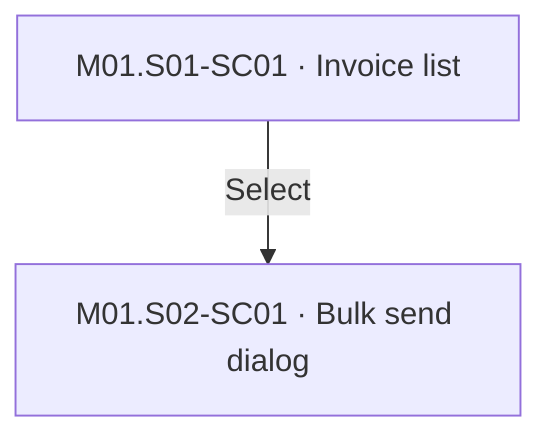

# Sitemap: Ledgerly
## Chart

FigJam: https://www.figma.com/board/sample (design references, G01)
## Screens
| Screen ID | Name | Status | UX file | Design |
|---|---|---|---|---|
| M01.S01-SC01 | Invoice list | Changed (I-001) | 03-ux/M01.S02-bulk-actions.md | https://www.figma.com/design/sample?node-id=1-2 |
| M01.S02-SC01 | Bulk send dialog | New (I-001) | 03-ux/M01.S02-bulk-actions.md | https://www.figma.com/design/sample?node-id=1-3 |

## Change log
| Version | Date | Change | CR / query / DEC |
|---|---|---|---|
| 1.0.0 | 2026-10-01 | Created | |
